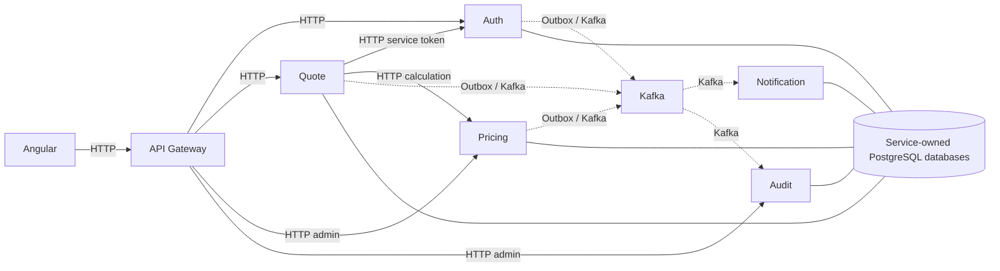
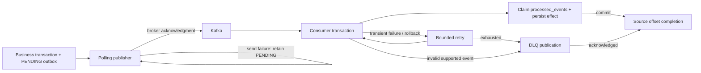

# Insurance Pricing Platform

## Overview

A car-insurance quote platform with CUSTOMER and ADMIN workflows, built with Angular and Spring Boot microservices. Quotes receive an immediate premium calculation; Kafka handles notifications and audit history asynchronously. Each backend domain owns its PostgreSQL database.

**Complete through PostgreSQL performance tuning and final portfolio polish.** Validation results and existing dependency advisories are disclosed in the [final report](docs/portfolio-validation.md). Pricing is educational, not actuarial. Notifications are simulated database records. This is a production-style engineering portfolio, not a production insurance system.

## Why I Built This Project

I built this project to practice full-stack engineering across frontend architecture, backend APIs, distributed transactions, security, reliability, testing and database performance. A deliberately small business domain makes failure handling and design decisions easier to inspect.

## Key Features

- **Customer UI:** registration, login, session restoration, quote creation, paginated history and historical detail. Quotes expire automatically after 30 days.
- **Admin UI:** immutable audit history with filters/detail; six-service Operations dashboard with partial-failure handling and manual/automatic refresh.
- **Admin APIs:** versioned pricing-rule management and customer enable/disable. These two workflows have no Angular administration pages.
- **Platform:** transactional outboxes, idempotent Kafka consumers, bounded retry/DLQ, RS256 JWTs, rotating refresh cookies, service credentials, locking, health/metrics and a Pricing circuit breaker.
- **Evidence:** real PostgreSQL/Kafka integration suites and reproducible query-plan optimization.

## Architecture Overview



The database node represents **five separate logical databases**, not shared tables. Auth alone signs user/service tokens. Gateway also collects health and curated metrics for Operations. See [database ownership and request sequences](docs/architecture.md).

| Service | Responsibility | Local port | Database |
| --- | --- | ---: | --- |
| API Gateway | Routing, authorization, CORS, Operations aggregation | 8080 | — |
| Auth | Users, sessions, service-token issuance, customer administration | 8081 | `auth_db` |
| Quote | Quotes, snapshots, expiration, Pricing orchestration | 8082 | `quote_db` |
| Pricing | Premium calculation, versioned rule administration | 8083 | `pricing_db` |
| Notification | Simulated notifications from events | 8084 | `notification_db` |
| Audit | Event audit trail and ADMIN read API | 8085 | `audit_db` |

## Technology Stack

| Area | Implementation |
| --- | --- |
| Frontend | Angular 22, TypeScript, NgRx SignalStore, Signals, RxJS, Reactive Forms |
| Backend | Java 25, Spring Boot 4.1.1, Spring Security, Spring Data JPA/JDBC, Flyway, Spring Cloud Gateway |
| Messaging / database | Kafka 4.1.2; PostgreSQL 17.11 |
| Infrastructure | Docker Compose; Maven Wrapper (Maven 3.9.16); npm lockfile |
| Testing | JUnit, Mockito, Testcontainers; Angular TestBed, Vitest, jsdom |
| Observability / resilience | Actuator, Micrometer, correlation IDs, Resilience4j |
| Security | RS256 JWTs, refresh-token rotation, service client credentials |

## Architecture Decisions

- **Synchronous Quote → Pricing:** quote creation needs an immediate premium. Failed calculation creates no partial quote or invented fallback premium.
- **Kafka for Notification/Audit:** these effects need not block the HTTP response; independent groups process the same event separately.
- **Transactional outbox:** business state and event intent commit together, avoiding a database-commit/direct-publish loss window.
- **Idempotent consumers:** at-least-once delivery permits duplicates; a database marker and side effect commit atomically.
- **RS256:** Auth signs with a private key; other services verify with public keys only.
- **Separate service identity:** Quote's machine token has a dedicated subject, scope and audience, independent of the customer's JWT.

See [engineering tradeoffs and scope](docs/engineering-tradeoffs.md).

## Reliability Flow



Auth, Quote and Pricing publish stored intent after commit. A crash after Kafka acceptance but before marking PUBLISHED can resend the event. Notification/Audit deduplicate by `(eventId, consumerName)`. Failed transactions roll back both marker and effect. Default consumer policy allows three total attempts with a fixed one-second backoff; permanent invalid input goes directly to DLQ. Failed DLQ publication leaves the source replayable. Unknown event types are intentionally skipped.

These are **at-least-once semantics**, including possible duplicate DLQ records. Producer retries have no cutoff; there is no producer DLQ or automatic replay tool. Details: [outbox](docs/transactional-outbox.md), [Kafka](docs/kafka-design.md), [retry/DLQ](docs/retry-and-dlq.md).

## Security Architecture

Login returns a short-lived access JWT held only in Angular memory and an opaque HttpOnly refresh cookie. Auth stores only a SHA-256 digest of the refresh token; refresh rotates it under a database row lock. Reload restores the session, and simultaneous protected 401 responses share one refresh request. Logout revokes the refresh token and clears the cookie.

Auth signs RS256 with its private RSA key. Gateway, Auth, Quote, Pricing and Audit validate access JWTs using public keys; roles and quote ownership are enforced at the owning service as well as Gateway. Quote obtains/caches a short-lived service token from Auth using client credentials. Internal Pricing requires `quote-service`, `pricing:calculate` scope and `pricing-service` audience; user JWTs cannot substitute for machine credentials.

**Known limits:** existing access JWTs can authorize until expiry after logout/disable. No immediate denylist, automatic key rotation or refresh-family revocation exists. Local RSA fixtures and service/database credentials are publicly known DEV/TEST ONLY. See [security checklist and cookie/CORS assumptions](docs/security.md).

## Database Design

Five databases (`auth_db`, `quote_db`, `pricing_db`, `notification_db`, `audit_db`) have service-owned Flyway migrations and UUID identities. There are no cross-service foreign keys or database reads. Quote snapshots preserve vehicle names, rule versions and premium breakdowns independently of later changes. Producers own `outbox_events`; consumers own `processed_events`.

[Schema inventory and constraints](docs/database-design.md) include ownership, indexes and migrations. Local Compose uses one shared development administrator account; it does not enforce database isolation with separate grants.

## PostgreSQL Performance

Disposable realistic datasets and `EXPLAIN (ANALYZE, BUFFERS)` justified four targeted indexes:

| Query | Before | After |
| --- | --- | --- |
| Audit correlation, 100k records | Sequential scan discards 99,997 rows | Bitmap index/heap lookup, sorts three rows |
| Global Quote history, 50k quotes | Sequential scan + sort | Ordered index-only ID page |
| Auth case-insensitive email, 15k users | Sequential scan | `upper(email)` expression index |
| Customer list, 14,850 customers | Scan + sort | Role/creation/ID ordered index |

The recorded Phase 27 run measured 12.785 → 0.109 ms for correlation and 17.950 → 0.101 ms for the first global Quote ID page. These are single local SQL observations, **not HTTP benchmarks or SLAs**. Exact totals still scan matching rows; deep offset pagination remains linear. Indexes increase write/storage costs. [Full evidence, unchanged paths and methodology](docs/phase-27-postgres-performance-validation.md) are preserved; the [final validation report](docs/portfolio-validation.md) records the fresh rerun.

## Testing Strategy

Unit/HTTP tests cover business rules, security and failure responses. PostgreSQL integration uses real Flyway, transactions, locking, concurrency and snapshot query-count checks. Kafka integration uses real brokers/databases for redelivery, outbox and DLQ behavior. Disposable E2E scripts run packaged services and real HTTP workflows. Frontend tests cover SignalStores, guards, interceptors, components and refresh coordination; production builds validate lazy routes and bundles.

## Engineering Scenarios Demonstrated

| Scenario | Concrete behavior |
| --- | --- |
| Optimistic locking | Two admins update one Pricing version: one commits, the other gets 409; only the winner emits intent |
| Pessimistic locking | Concurrent customer-status changes serialize; repeated same-state commands produce no extra event |
| Kafka redelivery | A committed processed-event marker prevents a second side effect |
| Outbox crash window | Kafka acceptance before status update may duplicate publication; consumers remain safe |
| Dependency outage | Auth/Pricing failures produce safe 502/503 responses without partial quotes |
| Circuit breaker | Repeated qualifying Pricing failures open the circuit; probes allow recovery |
| Refresh replay | A rotated refresh token is rejected if reused; no family-wide revocation claim |

## Project Structure

```text
frontend/                       Angular application and tests
services/
  api-gateway/                  HTTP entry point and Operations
  auth-service/                 Users, authentication, sessions
  quote-service/                Quote orchestration and snapshots
  pricing-service/              Calculation and rule administration
  notification-service/         Simulated notification consumer
  audit-service/                Audit consumer and read API
infrastructure/                 PostgreSQL/Kafka bootstrap and validation harnesses
docs/                           Current guides, historical specs and evidence
docker-compose.yml              Infrastructure only
mvnw                            Backend build/run wrapper
```

## Prerequisites and Local Setup

Use JDK 25, Docker with Compose and a running daemon, Node.js satisfying `^22.22.3 || ^24.15.0 || >=26.0.0`, and npm (repository pins 11.19.0). Maven Wrapper supplies Maven; Python 3 is needed only for validation harnesses. Commands below assume the repository root unless specified.

```bash
git clone https://github.com/kyawzintun/insurance-pricing-platform.git
cd insurance-pricing-platform
cp .env.example .env
docker compose up -d
docker compose ps -a
docker compose logs kafka-init
```

Wait for PostgreSQL/Kafka healthy and `kafka-init` exited with code 0. Compose starts **infrastructure only**, with PostgreSQL on `localhost:15432`, Kafka on `localhost:29092`. Applications default to the `local` profile. Defaults work without exporting `.env`; Compose reads it automatically, Maven does not. See [local setup and environment reference](docs/local-development.md) before overriding values.

### Running Services

Run each command in a separate terminal at the repository root. Start Auth/Pricing and consumers before trying quotes; migrations apply on service startup.

```bash
./mvnw -pl services/auth-service spring-boot:run
./mvnw -pl services/pricing-service spring-boot:run
./mvnw -pl services/notification-service spring-boot:run
./mvnw -pl services/audit-service spring-boot:run
./mvnw -pl services/quote-service spring-boot:run
./mvnw -pl services/api-gateway spring-boot:run
```

Check `http://localhost:8080/actuator/health` and individual service health endpoints. Use Ctrl-C for applications and `docker compose down` for infrastructure; named volumes persist. Ordinary startup never needs a database reset.

### Running Frontend

```bash
cd frontend
npm ci
npm start
```

Open `http://localhost:4200`. Browser calls go only to Gateway. API URL is build-time public configuration in `frontend/src/environments/environment.ts`.

### Running Tests

```bash
./mvnw verify
# Docker required for integration profiles:
./mvnw -Ppostgres-it verify
./mvnw -Pkafka-it verify
# In frontend/:
npm test
npm run build
```

[Validation guide](docs/testing.md) covers faster integration-only invocations, disposable E2E scripts, the performance harness and prerequisites. [Final results](docs/portfolio-validation.md) record checks performed during this polish.

### Demo Accounts / Admin Provisioning

No accounts are seeded. Register your own CUSTOMER in the UI, then log in. To demonstrate ADMIN, register a dedicated local account and follow the [DEV-only SQL promotion procedure](docs/local-development.md#admin-provisioning-dev-only); log in again afterward. There is no public ADMIN-registration endpoint.

## API Overview

All browser APIs use Gateway on port 8080; bearer authentication applies except register/login/refresh/logout. Refresh/logout use the refresh cookie.

| Area | Routes / operations |
| --- | --- |
| Auth | `POST /api/v1/auth/{register,login,refresh,logout}` |
| Quotes | `POST /api/v1/quotes`; `GET /api/v1/quotes` and `/{id}` |
| Vehicle references | `GET /api/v1/vehicles/brands` and `/{brandId}/models` |
| Admin customers | `GET /api/v1/admin/customers` and `/{id}`; `PATCH /{id}/{enable,disable}` |
| Admin pricing | `GET/POST /api/v1/admin/pricing/rules`; `GET/PUT /{id}`; `PATCH /{id}/{enable,disable}` |
| Admin audit | `GET /api/v1/admin/audit` and `/{id}` |
| Admin Operations | `GET /api/v1/admin/operations` |
| Internal, direct only | Auth `POST /api/v1/auth/service-token`; Pricing `POST /internal/v1/pricing/calculate` |

Admin suffixes are relative to their table row's base path. Service-token issuance is not exposed through Gateway. Full DTOs, filters and curl examples live in [service guides](services/README.md).

## Event Overview

All implemented contracts are v1. Main topics each have three partitions and replication factor one locally, plus a matching `.dlq` topic.

| Topic | Events | Producer | Consumers |
| --- | --- | --- | --- |
| `insurance.quote.events` | [QuotePriced](docs/quote-priced-event.md), [QuoteExpired](docs/quote-expired-event.md) | Quote | Notification, Audit |
| `insurance.user.events` | [UserRegistered](docs/user-registered-event.md) | Auth | Notification, Audit |
| `insurance.user.events` | [UserDisabled, UserEnabled](docs/user-status-events.md) | Auth | Audit; Notification intentionally skips |
| `insurance.pricing.events` | [PricingRuleCreated, Updated, Enabled, Disabled](docs/pricing-rule-events.md) (each prefixed `PricingRule`) | Pricing | Audit |

Keys are aggregate UUIDs (quote, user, pricing rule). Ordering is partition-local; no global ordering or exactly-once claim. [Kafka design](docs/kafka-design.md) explains envelope, group and recovery boundaries.

## Screenshots

No application screenshots are committed. [Capture checklist](docs/screenshots/README.md) lists real UI views to add manually; no mock images stand in for application evidence. Existing browser validation remains in historical reports.

## Completion, Tradeoffs and Future Improvements

All planned implementation milestones are complete, including Operations, PostgreSQL tuning and SignalStore migration. [Roadmap](docs/implementation-roadmap.md) separates completed work from optional future ideas. Scope intentionally excludes real notification providers, deployment infrastructure, actuarial pricing and production security certification. JWKS/key rotation, mTLS, DLQ replay tooling, cursor pagination, a tracing backend and deployment automation are possible future improvements, not required unfinished work.

## Portfolio Summary

Built a production-style insurance pricing platform using Angular and Spring Boot microservices, with Kafka workflows, transactional outboxes, idempotent consumers, PostgreSQL performance tuning, RS256 authentication and service-to-service security.

[Interview guide](docs/interview-guide.md) provides short explanations and concrete examples for the major engineering decisions.
