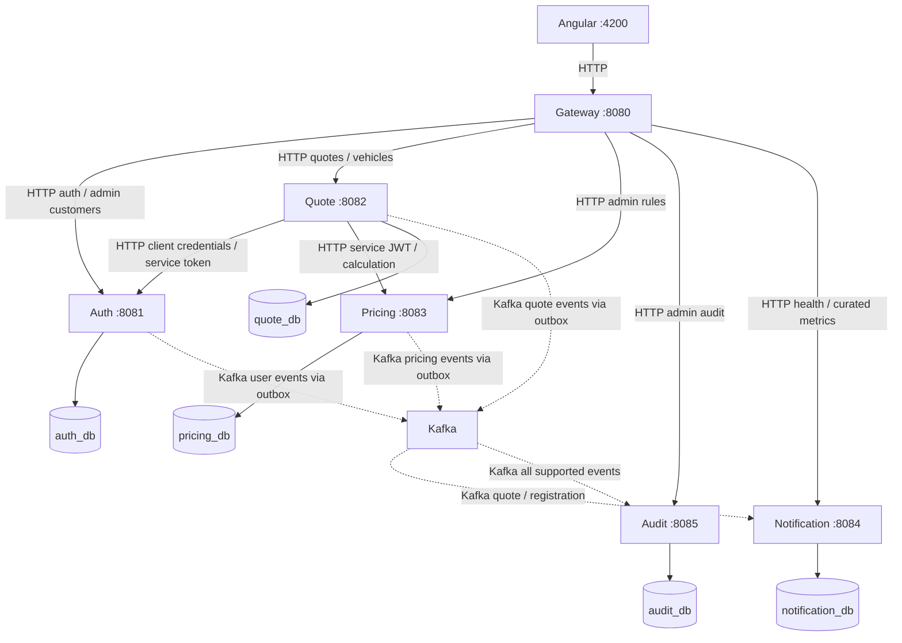
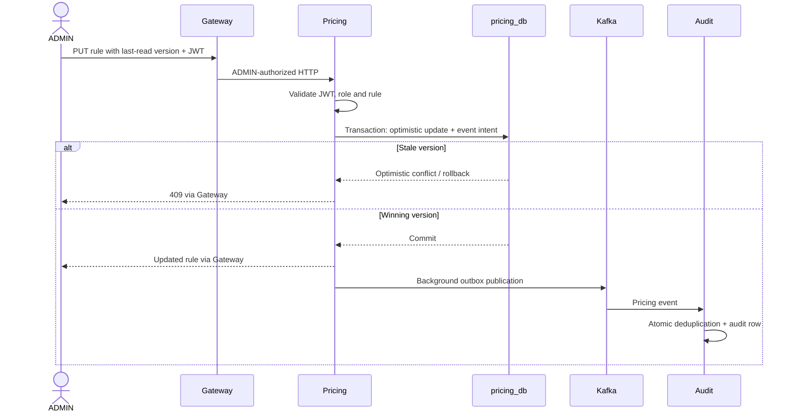

# Architecture

Current implementation: complete through portfolio polish. Solid arrows below mean synchronous HTTP; dotted arrows mean asynchronous Kafka publication/consumption. Angular state uses NgRx SignalStore, Reactive Forms and local Signals; see the [frontend guide](../frontend/README.md).



Gateway's Operations collector also calls Auth, Quote, Pricing and Audit health/readiness and protected numeric metrics concurrently; its own health is local. Failures produce a partial dashboard, not a failed whole-page response. Notification metrics are internal and unauthenticated; keep its port private. This diagram groups these extra monitoring calls in prose to preserve readability.

Each domain owns Flyway migrations and one logical PostgreSQL database. No cross-service SQL joins, foreign keys or schema generation. Local Compose shares one PostgreSQL server/account for convenience. HTTP DTOs and versioned JSON events cross service boundaries; entities do not. Layering is controller → service → repository with focused clients, security and event components.

## Create Quote

```mermaid
sequenceDiagram
  actor C as Customer
  participant G as Gateway
  participant Q as Quote
  participant A as Auth
  participant P as Pricing
  participant DB as quote_db
  participant K as Kafka
  participant N as Notification / Audit
  C->>G: POST /api/v1/quotes + user JWT
  G->>Q: Authorized HTTP request
  Q->>Q: Validate JWT, CUSTOMER and vehicle/input
  opt No usable cached service token
    Q->>A: Client credentials (direct HTTP)
    A-->>Q: Short-lived RS256 service JWT
  end
  Q->>P: Calculate + service JWT
  P->>P: Validate subject, audience, scope; load own rules
  P-->>Q: Premium and rule breakdown
  Q->>DB: Transaction: snapshots + PENDING outbox
  DB-->>Q: Commit
  Q-->>G: 201 stored quote
  G-->>C: 201
  Note over Q,K: Scheduled publisher, independent of response
  Q->>K: Stored event; await broker acknowledgment
  Q->>DB: Mark PUBLISHED
  K->>N: Independent consumer groups
  N->>N: Own DB transaction: marker + effect
```

A Pricing/Auth outage fails safely before quote persistence. The Pricing circuit breaker provides fast failure and later probes; no fallback premium is created. One controlled Pricing 401 can invalidate the cached service token and retry with a fresh token; this is not broad transport retry. A publisher crash after Kafka acceptance can resend the event.

## Login and Refresh

```mermaid
sequenceDiagram
  participant B as Browser
  participant G as Gateway
  participant A as Auth
  participant DB as auth_db
  B->>G: POST login
  G->>A: Forward credentials
  A->>DB: Verify BCrypt; persist refresh digest
  A-->>G: Access JWT + HttpOnly refresh cookie
  G-->>B: JWT to memory; cookie to browser
  B->>G: POST refresh + cookie (reload / protected 401)
  G->>A: Forward cookie
  A->>DB: Lock token row; revoke old, insert new digest
  DB-->>A: Atomic commit
  A-->>B: New access JWT + rotated cookie via Gateway
```

Concurrent Angular 401s share one refresh. Logout revokes the refresh token, but previously issued access JWTs remain valid until expiry. SameSite and exact-origin credentialed CORS assumptions are in [security](security.md).

## Admin Pricing Change



## Reliability and Storage

See [transactional outbox](transactional-outbox.md), [retry/DLQ](retry-and-dlq.md), [Kafka contracts](kafka-design.md) and [database design](database-design.md). Producer session advisory locks serialize dispatchers per service without holding a transaction during Kafka I/O. Consumer marker and side effect share a local transaction. No distributed transaction or exactly-once delivery is claimed.

PostgreSQL tuning added four measured indexes without changing business behavior; [plan evidence](phase-27-postgres-performance-validation.md) records unchanged queries and write costs. [Tradeoffs](engineering-tradeoffs.md) covers deployment, retention, tracing and security limits. Historical designs remain in [phase specs](specs/README.md) and dated validation reports.
