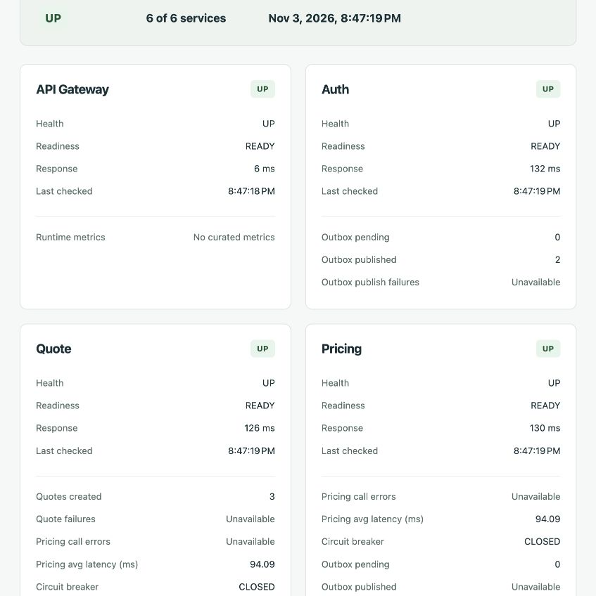
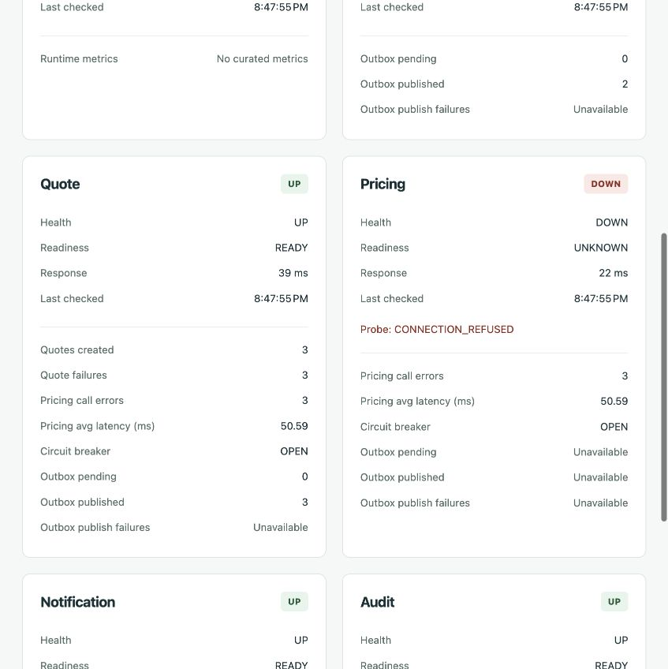

# Phase 27 — Validation

> Historical milestone record: scope, commands, counts and limitations below describe that revision. For the completed implementation and current run instructions, start with the [root README](../README.md).

Validated 2026-11-03 (Asia/Bangkok). Phase 27 implements the Centralized Operations Dashboard;
no database-performance or next-phase work is included.

## Results

| Check | Result |
| --- | --- |
| `./mvnw -B package` | PASS: 456 unit/HTTP tests across all six applications; all jars packaged |
| Gateway tests | PASS: 56, including six new Operations scenarios and all existing route/security tests |
| Angular `npm test` | PASS: 121 tests in 12 files, including 13 Operations cases |
| Angular `npm run build` | PASS: production build, including lazy Operations chunk |
| Disposable six-service E2E | PASS: process exit 0; PostgreSQL/Kafka and ephemeral signing credentials |
| Live browser ADMIN dashboard | PASS: healthy → Pricing outage → recovery, with manual and automatic refresh |
| Live browser CUSTOMER access | PASS: Operations/Audit nav absent; direct /admin/operations redirected to dashboard |
| `git diff --check` | PASS |

Only Gateway and Angular production code changed. No database migrations, event contracts,
pricing/quote rules, service-auth scopes, consumer/outbox behavior or monitoring stack changed.
Existing backend unit/security/auth/quote/event reliability tests remain in the full Maven run.
No need to rerun historical PostgreSQL/Kafka profiles for unchanged database/message code:
the disposable E2E additionally exercised actual PostgreSQL, Kafka, outbox and both consumers.

## Controlled backend tests

OperationsTests starts five controlled local HTTP targets and a real secured Gateway. It checks:

- ADMIN 200, CUSTOMER 403, anonymous 401, unknown proxy child 404 and no-store response.
- Exactly the six stable IDs, Gateway self-health, UP/READY states and timestamps/latencies.
- Count/gauge/timer mapping, 250 ms average from 2.5 seconds / 10 calls, closed/half-open state,
  consumer metrics and null missing metrics without hiding otherwise healthy cards.
- One/multiple failures preserve HTTP 200 and other cards; recovery returns overall UP.
- Short timeout and malformed status map to safe error codes; no downstream metadata/body leaks.
- A barrier across five remote health calls proves concurrent fan-out: sequential dispatch could
  not release the barrier before the deadline and would fail the all-UP assertion.
- ADMIN credentials reach protected metrics, never public health/readiness or Notification.

Existing Gateway tests retain auth, quote/vehicle, pricing-admin, customer-admin, audit-admin,
JWT algorithm/signature, authorization, CORS, refresh cookies and correlation coverage.

## Angular tests

The Operations tests use real NgRx state/effects and HttpTestingController. They verify one
Gateway GET, six cards, textual UP/DOWN/DEGRADED/readiness, partial-failure rendering, circuit
and human-readable metrics, loading/overlap prevention, manual refresh, pausable 15-second
refresh, timer/request cleanup, safe aggregator errors with a labeled previous snapshot,
null metrics, escaped HTML and an allowlisted metric-key presentation. Session changes clear
state/cancel requests. ADMIN/CUSTOMER route and navigation behavior reuse adminGuard.

## Disposable E2E and browser results

Command: `PHASE27_BROWSER_CHECK=true python3 infrastructure/validation/phase27-operations-e2e.py`
with the development frontend on localhost:4200. The optional browser checkpoints use a named
ready/continue file handshake; normal automated runs omit the flag and complete without pauses.
Gateway uses localhost:8080 only for the browser variant; all other ports/infrastructure are
isolated. The harness cleans up its processes/containers/private signing key in finally.

1. Started Gateway/Auth/Quote/Pricing/Notification/Audit plus disposable PostgreSQL 17.11 and
   Kafka 4.1.2; registered CUSTOMER/ADMIN, logged in, verified refresh/RS256 regression and routes.
2. Created three quotes. Overview returned all six UP/READY, quoteCreated=3, nonzero Pricing
   latency, circuit CLOSED, outboxPublished≥3 and both consumer processed counters≥3.
3. Signed into Angular as ADMIN and opened Operations via its navigation. Browser showed
   6 of 6 services healthy, all six cards, real metrics and null metrics as Unavailable. Automatic
   refresh advanced last-refresh timestamps. Local browser QA found and fixed an inherited
   global input-size style on the new checkbox using component-scoped CSS.
4. Stopped Pricing. API and browser showed Pricing DOWN, readiness UNKNOWN, safe
   CONNECTION_REFUSED, overall DEGRADED and 5 of 6 healthy. All other cards stayed UP.
5. Triggered three failed quote attempts: quote/outbox counts unchanged, Pricing errors=3,
   circuit OPEN, and browser displayed the OPEN state and error counts from Quote telemetry.
6. Paused auto-refresh and used manual Refresh in the live page. Remaining services and metrics
   continued to render while Pricing-local metrics were Unavailable.
7. Restarted Pricing. Overview returned UP; a quote probe succeeded and circuit CLOSED.
   Manual browser refresh showed 6 of 6, Pricing UP/READY, CLOSED, quoteCreated=4 and continued
   Notification/Audit processing. Prior failure counters remained runtime measurements.
8. Signed out, signed in as CUSTOMER: Operations/Audit nav absent, customer links intact;
   direct navigation to /admin/operations redirected to dashboard. Signed out and closed test tab.
9. Fixed DTO/log scans rejected internal hostnames, raw measurements/tags, Authorization,
   actual user JWTs, refresh credential, client secret and private-key material. Verifier jars
   and verifier process environments retained private-key isolation.
10. Harness exited 0 and removed its disposable infrastructure; development server was stopped.

Final harness output:

```text
PASS: one ADMIN operations API; CUSTOMER 403 and anonymous 401; exactly six healthy cards; curated runtime metrics; Pricing DOWN and platform DEGRADED with other cards UP; OPEN circuit telemetry from Quote; no partial quote/outbox; Pricing restored UP/CLOSED; safe fixed DTO.
PASS: RS256 login/refresh regression and log redaction; no private signing material in verifier jars/environments.
```

Browser evidence:





## Limits and completion

Metrics are process-local, reset on restart and are not a distributed atomic/history snapshot.
Unavailable metrics are null; missing metrics alone do not degrade health. Pricing-client data
is owned by Quote. Consumer health reflects local container lifecycle, not broker lag. Static
trusted origins, per-exchange timeouts and bounded bodies apply; no cross-user request cache
or rate limiter is added. No history, alerting, discovery platform, Grafana/Prometheus server,
database performance work or next-phase work was implemented.

Phase 27 — Centralized Operations Dashboard is complete and ready for the next focused phase.
See [full API, configuration and operations specification](specs/phase-27-centralized-operations.md).

## File inventory

- `.env.example`
- `README.md`
- `docs/architecture.md`
- `docs/images/phase-27-operations-healthy.png`
- `docs/images/phase-27-operations-outage.png`
- `docs/implementation-roadmap.md`
- `docs/phase-27-validation.md`
- `docs/security.md`
- `docs/specs/phase-27-centralized-operations.md`
- `frontend/README.md`
- `frontend/src/app/app.component.html`
- `frontend/src/app/app.config.ts`
- `frontend/src/app/app.routes.ts`
- `frontend/src/app/core/operations/operations-api.service.ts`
- `frontend/src/app/features/operations/operations.component.css`
- `frontend/src/app/features/operations/operations.component.html`
- `frontend/src/app/features/operations/operations.component.ts`
- `frontend/src/app/features/operations/operations.spec.ts`
- `frontend/src/app/store/operations/operations.store.ts`
- `infrastructure/validation/phase27-operations-e2e.py`
- `services/api-gateway/README.md`
- `services/api-gateway/src/main/java/com/insurance/platform/gateway/config/GatewaySecurityConfiguration.java`
- `services/api-gateway/src/main/java/com/insurance/platform/gateway/operations/LocalOperationsHealth.java`
- `services/api-gateway/src/main/java/com/insurance/platform/gateway/operations/OperationsAggregator.java`
- `services/api-gateway/src/main/java/com/insurance/platform/gateway/operations/OperationsController.java`
- `services/api-gateway/src/main/java/com/insurance/platform/gateway/operations/OperationsOverview.java`
- `services/api-gateway/src/main/resources/application.yml`
- `services/api-gateway/src/test/java/com/insurance/platform/gateway/OperationsTests.java`
